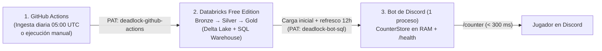

# deadlock-counterbuild-bot (V1)

Plataforma de **Data Engineering en Databricks + Bot de Discord de baja latencia** para **Deadlock**, que recomienda el Top de ítems de respuesta táctica (*counter-building* 1v1) en **menos de 2 segundos** usando únicamente herramientas gratuitas y sin tarjeta de crédito.

## Qué rol cumple cada pieza
* **GitHub Actions** ([daily_ingest_and_pipeline.yml](file:///c:/Users/Mauricio/Mi%20unidad/Ing.%20Informatica/Proyectos/deadlock-counterbuild-bot/.github/workflows/daily_ingest_and_pipeline.yml)): descarga diariamente partidas reales y catálogos desde `api.deadlock-api.com`, los sube al Volume de Databricks y dispara el pipeline Medallion. Corre automáticamente a las `05:00 UTC` y también se puede lanzar a demanda con **Run workflow** (no se dispara en cada `git push`).
* **Databricks Free Edition** ([data_pipeline/](file:///c:/Users/Mauricio/Mi%20unidad/Ing.%20Informatica/Proyectos/deadlock-counterbuild-bot/data_pipeline)): es la **única base de datos y motor analítico**. Transforma JSON crudos en Delta Lake (`Bronze → Silver → Gold`) calculando el `win_rate_delta` por `(aliado, enemigo, ítem)`.
* **Bot de Discord** ([bot/](file:///c:/Users/Mauricio/Mi%20unidad/Ing.%20Informatica/Proyectos/deadlock-counterbuild-bot/bot)): un único proceso Python *stateless* que carga la tabla Gold en memoria RAM al arrancar y la refresca cada 12 horas en segundo plano. No usa PostgreSQL ni disco local, y responde `/counter` en milisegundos.

## Tutorial de Despliegue (seguir en orden)
1. **[docs/databricks_setup.md](file:///c:/Users/Mauricio/Mi%20unidad/Ing.%20Informatica/Proyectos/deadlock-counterbuild-bot/docs/databricks_setup.md)** — Crear esquema/volumen en Unity Catalog, generar los 2 tokens PAT (`deadlock-bot-sql` y `deadlock-github-actions`), obtener datos del SQL Warehouse y ejecutar el workflow en GitHub Actions.
2. **[docs/discord_setup.md](file:///c:/Users/Mauricio/Mi%20unidad/Ing.%20Informatica/Proyectos/deadlock-counterbuild-bot/docs/discord_setup.md)** — Crear la aplicación en Discord Developer Portal, obtener `DISCORD_TOKEN` e invitar el bot con permisos mínimos.
3. **[docs/deployment.md](file:///c:/Users/Mauricio/Mi%20unidad/Ing.%20Informatica/Proyectos/deadlock-counterbuild-bot/docs/deployment.md)** — Elegir alojamiento 24/7 gratuito sin tarjeta (incluye tutorial paso a paso para **Azure for Students**, alternativa **Render + monitor HTTP** y creación exacta del servicio `systemd` o Docker).

## Documentación Técnica
* [docs/architecture.md](file:///c:/Users/Mauricio/Mi%20unidad/Ing.%20Informatica/Proyectos/deadlock-counterbuild-bot/docs/architecture.md): decisiones de arquitectura, manejo de *auto-stop/auto-start* del SQL Warehouse y seguridad de credenciales.
* [docs/data_model.md](file:///c:/Users/Mauricio/Mi%20unidad/Ing.%20Informatica/Proyectos/deadlock-counterbuild-bot/docs/data_model.md): definición matemática de `win_rate_delta`, tablas Delta Lake y esquema real de `api.deadlock-api.com`.

## Preguntas Frecuentes (FAQ)
* **¿El Serverless Starter Warehouse de Databricks debe quedar encendido 24/7?** No. Se suspende automáticamente tras unos minutos sin uso (*auto-stop*) y Databricks lo despierta solo (*auto-start*) cada 12 h cuando el bot refresca su caché en RAM. Durante las partidas, `/counter` nunca espera al Warehouse.
* **¿Qué pasa si cambio de servidor o vence mi suscripción de estudiante?** Como el bot no guarda base de datos ni estado local, migrarlo a otro host (por ejemplo entre Azure y Render) toma unos 5 minutos: clonar el repositorio, copiar `.env` y arrancar el proceso.
* **¿Se puede usar Docker o correr directo en Python?** Ambas opciones están soportadas ([docker-compose.yml](file:///c:/Users/Mauricio/Mi%20unidad/Ing.%20Informatica/Proyectos/deadlock-counterbuild-bot/docker-compose.yml) o `systemd`). En VMs pequeñas de 0.5–1 GB de RAM se recomienda `Python + systemd` por su menor consumo (~60–90 MB de RAM).
