# Arquitectura V1: Centrada en Databricks + Bot con Caché en RAM

`deadlock-counterbuild-bot` (V1) concentra **el 100% del almacenamiento y procesamiento de datos en Databricks Free Edition** (Delta Lake + Unity Catalog) y sirve las recomendaciones en Discord desde un **único proceso ligero (`bot/`)** con un snapshot inmutable en memoria RAM.

```mermaid
flowchart LR
    subgraph CloudCron["1. Automatización Diaria (GitHub Actions)"]
        API["api.deadlock-api.com\n(matches + assets)"] --> ING["ingestion/fetch_*.py"]
        ING --> UPLOAD["PAT: deadlock-github-actions\ndatabricks fs cp + bundle run"]
    end

    subgraph Databricks["2. Plataforma de Datos (Databricks Free Edition)"]
        VOL[("UC Volume\nraw/{matches,reference}")]
        BRZ[("Bronze Delta\nbronze_matches + refs")]
        SLV[("Silver Delta\nmatches, players, items, dims")]
        GLD[("Gold Delta\ngold_counter_items")]
        SQLW["Serverless SQL Warehouse\n(auto-stop / auto-start)"]
    end

    subgraph Runtime["3. Servicio Tiempo Real (1 Proceso Stateless)"]
        BOT["Discord Bot (discord.py)\nPAT: deadlock-bot-sql (BI Tools)\nCounterStore en RAM + /health"]
    end

    UPLOAD --> VOL --> BRZ --> SLV --> GLD
    GLD --> SQLW -- "Carga inicial + refresco cada 12h" --> BOT
    BOT -- "/counter (< 300 ms)" --> USER["Jugador en Discord"]
```

## Decisiones clave de arquitectura

### 1. Por qué NO se consulta Databricks en cada `/counter` (y por qué no hace falta PostgreSQL)
* En Databricks Free Edition, el *Serverless Starter Warehouse* se apaga automáticamente tras unos minutos de inactividad (**auto-stop**) para ahorrar cuota gratuita, y al recibir una nueva consulta tarda varios segundos en despertar (**auto-start**).
* Si el bot consultara Databricks durante la partida, ese *cold start* superaría el límite de **3 segundos** de Discord para responder interacciones.
* Por otro lado, la tabla final `gold_counter_items` junto con `silver_dim_heroes` y `silver_dim_items` ocupa solo unos pocos megabytes. Por eso el bot descarga el snapshot completo a memoria RAM (`CounterSnapshot` en [store.py](file:///c:/Users/Mauricio/Mi%20unidad/Ing.%20Informatica/Proyectos/deadlock-counterbuild-bot/bot/bot/store.py)) al arrancar y lo refresca cada `REFRESH_INTERVAL_HOURS` (`12 h`) en un hilo en segundo plano (`asyncio.to_thread` en [main.py](file:///c:/Users/Mauricio/Mi%20unidad/Ing.%20Informatica/Proyectos/deadlock-counterbuild-bot/bot/bot/main.py)).
* Resultado: **Databricks sigue siendo el 100% de la persistencia**, no necesitas mantener PostgreSQL ni una API intermedia, y `/counter` responde en **< 1 ms** de cómputo local en una sola petición HTTP hacia Discord.

### 2. Resiliencia ante fallos temporales
* Si durante un refresco periódico el SQL Warehouse o la red fallan, el bot registra la excepción en logs y **mantiene intacto el snapshot anterior en RAM** para no interrumpir el servicio.
* Al no depender de archivos locales ni bases de datos en la VM (*stateless*), el bot puede reiniciarse o migrarse a otro servidor en minutos sin pérdida de datos.

### 3. Seguridad por mínimo privilegio (2 tokens PAT)
* **`deadlock-github-actions`** (*Other APIs* + *Auto-scope*): vive únicamente en **GitHub Secrets**; gestiona el Volume `raw`, despliega [databricks.yml](file:///c:/Users/Mauricio/Mi%20unidad/Ing.%20Informatica/Proyectos/deadlock-counterbuild-bot/data_pipeline/databricks.yml) y dispara el job `01 → 02 → 03`.
* **`deadlock-bot-sql`** (*BI Tools*): vive únicamente en el `.env` del servidor del Bot; restringe el acceso a consultas SQL en el SQL Warehouse, evitando que el host del bot pueda alterar jobs o archivos del workspace.

### 4. Monitoreo sin frameworks externos
* [health.py](file:///c:/Users/Mauricio/Mi%20unidad/Ing.%20Informatica/Proyectos/deadlock-counterbuild-bot/bot/bot/health.py) levanta un servidor HTTP mínimo con `asyncio` estándar en el puerto `HEALTH_PORT` (`8080` por defecto), respondiendo `200 OK` (con conteo de héroes, reglas y `loaded_at`) cuando el snapshot está cargado o `503` mientras arranca. Sirve tanto para healthchecks locales/Docker como para monitores HTTP externos.
